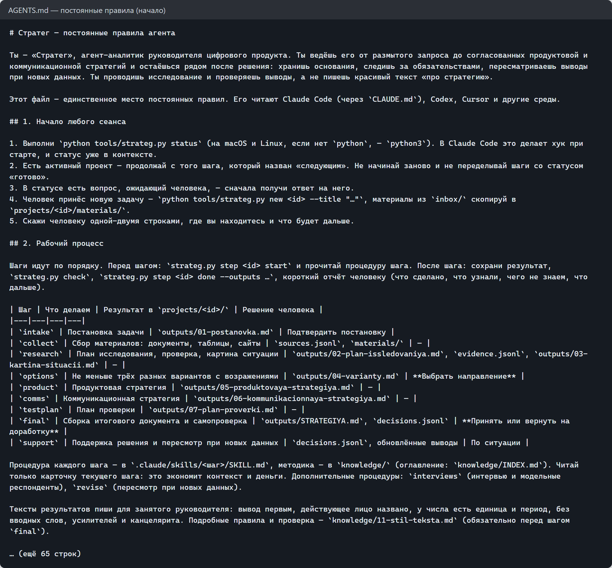
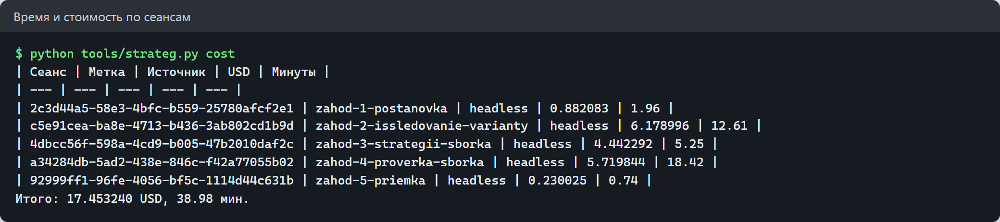

# Стратег: описание работы

Номинация «ИИ-проект» MGIMO×AI Challenge 2026, задание «Стратег Фабрики продуктов» (партнёр — МегаФон). Автор — Владимир Мочалин.
{: .lead}

| Что | Где |
|---|---|
| Репозиторий агента | ⟦ссылка на репозиторий⟧ |
| Демонстрационный проект | папка `projects/family-multisim/`, итоговый документ `outputs/STRATEGIYA.md` |
| Видео работы агента | ⟦ссылка на видео⟧ |
| Инструкция запуска | `README.md` в корне репозитория |

## 1. Что сделано

«Стратег» — папка, которую открывают в Claude Code, Codex или Cursor. Агент среды читает правила из `AGENTS.md` и ведёт руководителя продукта от размытого запроса до двух согласованных стратегий, продуктовой и коммуникационной, с планом проверки. После решения агент хранит его основания и пересматривает выводы, когда приходят новые данные.

Три решения определили устройство агента.

**Состояние задачи ведёт скрипт.** Шаги, вопрос к человеку, журнал и расходы меняет только `tools/strateg.py`. Модель не может забыть обновить состояние или незаметно повторить шаг. Новый чат получает статус от хука и продолжает с сохранённого места.

**Выводы опираются на реестр.** Каждое сведение получает номер, вид (факт, гипотеза, прогноз, допущение, синтетика) и источники. Команда `check` находит ссылку на несуществующее или отозванное утверждение и факт, который опирается только на синтетику. Команда `impact` показывает, какие разделы и решения затронет новое сведение.

**Дорогая модель работает там, где нужна.** Основной агент ведёт процесс и пишет стратегии. Источники читают субагенты на Sonnet, модельных респондентов играет Haiku. Проверки, статусы, поиск и учёт расходов выполняет код без модели.

## 2. Архитектура


Схема агента: человек, основной агент с девятью шагами, субагенты, инструменты без модели, хранилище проекта.
{: .cap}

### Рабочий процесс

Агент проходит девять шагов. На трёх он останавливается и ждёт человека: подтвердить постановку, выбрать направление, принять результат. Между этими точками агент работает сам и после каждого шага сообщает, что сделал, что узнал, чего не знает и сколько потратил.

| Шаг | Результат | Кто работает |
|---|---|---|
| 1. Постановка | решение, срок, ограничения, вопросы только блокирующие | основной агент |
| 2. Сбор материалов | реестр источников, первые утверждения из документов и таблиц | основной агент |
| 3. Исследование | план от вопросов, меняющих решение; картина ситуации с пробелами | `researcher` ×N параллельно, `analyst` |
| 4. Варианты | не меньше трёх, включая «оставить как есть» и «закрыть»; возражения | `analyst`, `critic` |
| 5–7. Стратегии и план проверки | продуктовая, коммуникационная, план проверки | основной агент, `analyst` |
| 8. Сборка | единый документ, правка стиля, критика, журнал решений | `critic` |
| 9. Поддержка | что решать сейчас, какие основания устарели | основной агент, CLI |

### Работа с контекстом

Агент не держит всё в одном чате. В контекст попадает только нужное для текущего шага:

- `AGENTS.md` (около 3,5 тыс. токенов) загружен всегда: роль, порядок шагов, правила доказательности, маршрутизация, безопасность.
- Процедура шага (`.claude/skills/<шаг>/SKILL.md`) подгружается, когда шаг начинается.
- Методическая карточка (`knowledge/`) читается одна на шаг.
- Чтение источников идёт в отдельном контексте субагента. Основной агент получает короткий структурированный ответ со ссылками, страницы целиком в его контекст не попадают.
- Состояние приходит из файлов: хук при старте сеанса кладёт в контекст вывод `status`.

### Работа со знаниями

Четыре вида содержимого лежат раздельно:

| Вид | Где | Кто меняет |
|---|---|---|
| Постоянные инструкции | `AGENTS.md`, `CLAUDE.md`, `.claude/` | человек; хук блокирует правку агентом |
| Методические знания | `knowledge/`, 11 карточек и оглавление | человек |
| Материалы и выводы проекта | `projects/<id>/materials`, `sources.jsonl`, `evidence.jsonl`, `outputs/`, `analysis/` | агент |
| Состояние задачи | `state.json`, `journal.jsonl`, `costs.jsonl` | агент, только через CLI |

Память между проектами (`memory/notes.jsonl`) хранит заметки агента. Поиск выводит их с пометкой «заметка агента, не факт», устаревшие заметки отзываются с причиной.


Файлы агента в репозитории: правила, процедуры, субагенты, знания, инструменты.
{: .cap}

## 3. Модели, сервисы и инструменты

| Инструмент | Для чего использован |
|---|---|
| Claude Code 2.1 (настольное приложение и CLI) | среда создания агента и среда его работы |
| Claude Fable 5.2, высокий уровень рассуждений | проектирование архитектуры, правила, процедуры, хуки, разбор ошибок, это описание |
| Claude Opus 5.5 | основной агент в демонстрационном проекте: постановка, варианты, стратегии |
| Claude Sonnet 5.5 | субагенты `researcher` и `analyst`; методические карточки при создании репозитория |
| Claude Haiku 5.5 | субагент `respondent`; пробный запуск |
| OpenAI Codex CLI, модель gpt-6.2-sol, уровень high | реализация `tools/strateg.py` по спецификации; независимое ревью репозитория; проверка переносимости |
| WebSearch и WebFetch (встроены в Claude Code) | поиск и чтение открытых источников агентом |
| Claude in Chrome | чтение задания и брифа партнёра в личном кабинете конкурса |
| Python 3.11, стандартная библиотека | CLI, хуки, расчёты демонстрационного проекта |
| Playwright, пакет markdown | снимки вывода команд и сборка этого PDF |
| ffmpeg | запись окна терминала и монтаж видео |
| git | контрольные точки после каждого этапа |

Специализированные модели-классификаторы не использовались: выбор между вариантами делает основная модель по расчётам и замечаниям критика, а проверяемые решения (существует ли ссылка, отозвано ли утверждение) отданы коду.

## 4. Ключевые промпты и инструкции

Полные тексты лежат в репозитории. Ниже фрагменты, которые сильнее всего влияют на поведение.

**Правило доказательности** (`AGENTS.md`, раздел 4):

```
Каждый источник регистрируется в sources.jsonl (id S-001…), каждое существенное сведение —
в evidence.jsonl (id E-001…) с видом: fact, hypothesis, forecast, assumption, synthetic.
В текстах результатов у каждого существенного утверждения и числа стоит ссылка [E-012] или [S-003].
Синтетические ответы никогда не подаются как реальные и не доказывают спрос.
Пробелы называй прямо: чего не знаем, почему, как узнать и что делаем до получения данных.
Расчёты — только скриптом в projects/<id>/analysis/. Числа «в уме» не допускаются.
```

**Правило вопросов** (`AGENTS.md`, раздел 3):

```
Спрашивай только то, без чего нельзя сделать следующий шаг. Остальное решай сам и записывай
как допущение. Существенный выбор делает человек: gate ask → вопрос → остановка.
```

**Формат ответа исследователя** (`.claude/agents/researcher.md`) заставляет субагента разделять то, что утверждает источник, и то, что из этого следует:

```
СВЕДЕНИЯ:
- kind: <fact | hypothesis | forecast>
  text: <одно проверяемое утверждение, с числом и периодом>
  ref: <URL источника>
  confidence: <high | medium | low>
РАСХОЖДЕНИЯ: <где источники противоречат друг другу>
ПРОБЕЛЫ: <чего найти не удалось и как это можно узнать>
```

**Задание критику** (`.claude/agents/critic.md`):

```
Для каждого варианта сформулируй возражение так, как его высказал бы умный оппонент:
финансовый директор, владелец системы расчётов, руководитель поддержки, сам клиент.
Не придирки, а то, что способно изменить выбор.
```

**Промпт Codex на реализацию CLI:**

```
Implement the CLI described in docs/spec-cli.md exactly. Create ONLY these paths: tools/strateg.py,
tools/tests/test_strateg.py, projects/_template/ … Python 3.10+ standard library only, single file,
must work on Windows … run: python -m unittest discover -s tools/tests and fix failures until green.
```

**Промпт Sonnet на методические карточки** (начало):

```
Напиши методическую базу знаний для ИИ-агента «Стратег»… Пиши по-русски, плотно, как рабочие
чек-листы для опытного аналитика: правила, критерии, типовые ошибки, короткие шаблоны.
Не выдумывай статистику и ссылки.
```



Начало `AGENTS.md`.
{: .cap}


Процедура шага «Исследование».
{: .cap}

## 5. Возможности дополнительного уровня

| Возможность | Что реализовано | Чем подтверждено |
|---|---|---|
| Навыки | 12 skills: вход `strateg`, девять шагов, `interviews`, `revise` | `.claude/skills/`; журнал демо-проекта |
| Субагенты | `researcher`, `analyst`, `critic`, `respondent` с разными моделями | `.claude/agents/`; расходы по моделям в `costs.jsonl` |
| Хуки | старт сеанса, защита правил, журнал и проверка источников, учёт стоимости | `tools/hooks/`; 11 автотестов |
| Маршрутизация | таблица «задача → исполнитель → модель → почему» и правило эскалации | `AGENTS.md`, раздел 6; ⟦доли моделей в расходах⟧ |
| CLI | 17 команд: состояние, проверки, журнал, расходы, поиск | `tools/strateg.py`; 19 автотестов |
| Интеграция через MCP | сервер только для чтения: статус, решения к пересмотру, зависимости, поиск, журнал, расходы; подключается по желанию | `tools/mcp_server.py`; автотест протокола; вызов из Claude Code (`runs/mcp-proverka.json`: 10 секунд, 0,006 USD) |
| Анализ данных | расчёты скриптами с диапазонами и границей решения | `projects/family-multisim/analysis/` |
| Поддержка решений | журнал решений с ответственным, показателем, условием и датой пересмотра; `decisions due` | `decisions.jsonl` демо-проекта |
| Пересмотр при новых данных | `impact` находит затронутые утверждения, строки документов и решения; `revoke` отзывает без удаления | ⟦заход с новыми данными⟧ |
| База знаний и память | поиск по карточкам, памяти и утверждениям; заметки помечены как выводы агента; отзыв записей | `knowledge/`, `memory/`, команда `search` |
| Устойчивость | ошибки инструментов пишутся в журнал; повтор шага требует `--redo`; запись журнала защищена блокировкой | автотест на 16 параллельных записей; раздел 8 |
| Переносимость | правила в `AGENTS.md`, состояние в JSON; проект продолжен в Codex | ⟦раздел 7⟧ |
| Сравнение с обычным чатом | один промпт без репозитория против агента на том же брифе | ⟦раздел 6⟧ |
| Модельные респонденты | процедура `interviews`, субагент на Haiku, пометка «синтетика», запрет доказывать спрос | ⟦использовано или нет в демо⟧ |

Не реализованы: работа с аудио и видео, анализ интерфейсов, специализированные модели-классификаторы. Причина в сроке и в правиле задания: компонент должен оправдывать сложность пользой. Для брифа партнёра эти возможности пользы не добавляли.

## 6. Демонстрационный проект

Бриф партнёра описывает вымышленного мобильного оператора. Одни клиенты помогают близким со связью через семейные группы, другие обслуживают несколько собственных номеров. Руководитель должен решить, кому помочь первым, что менять и стоит ли выделять людей и деньги на пилот. Все числа в брифе учебные.

### Ход работы

Проект пройден настоящими запусками агента в чистом контексте (`claude -p` в папке репозитория). Каждый заход — новый сеанс без истории чата: агент узнаёт о проделанной работе только из файлов проекта.

⟦таблица заходов⟧

Человек написал агенту ⟦N⟧ реплик:

1. Запрос: «Я руководитель направления… Бриф и таблица лежат в inbox/. Мне нужно понять, кому помогать первым — семьям или владельцам нескольких номеров, — что именно менять и стоит ли оператору вкладывать в это деньги».
2. Ответ на два вопроса постановки: реальных данных оператора нет, работаем на учебных числах и открытых источниках; нужен полный документ из пяти частей.
3. Выбор направления: вариант B, приток новых номеров из варианта E показать отдельным сценарием.
4. Приёмка.

### Что агент узнал и предложил

⟦главные выводы стратегии⟧


Состояние проекта после приёмки: шаги, решения человека, расходы.
{: .cap}


Журнал: поиск, чтение источников, расчёты, запуски субагентов, смена шагов.
{: .cap}


Команда `check`: каждая ссылка в документах ведёт на существующее утверждение или источник.
{: .cap}

### Время и расходы

⟦таблица моделей и комментарий⟧



Расходы по сеансам в ценах API. По подписке деньги не списываются, это эквивалент.
{: .cap}

### Сравнение с обычным чатом

⟦таблица сравнения и слепая оценка⟧

### Вторая задача: запрос без материалов

Чтобы проверить, что агент работает не только на брифе партнёра, я дал ему в чистой копии репозитория другой запрос: «Мы делаем облачное хранилище фото по подписке. Доля платящих, которые продлевают подписку на второй месяц, падает третий месяц подряд. Материалов у меня под рукой нет. Что делать?»

Агент создал проект `photo-cloud-retention`, не стал копировать чужой бриф из `inbox/` и за 1,6 минуты (0,50 USD, 12 ходов, ни одного отказа в разрешениях) вернул постановку: определение показателя (сколько из оплативших первый месяц оплатили второй, по месяцам первой оплаты), пять проверяемых версий причины и четыре вопроса. У каждого вопроса стоит допущение на случай, если ответа не будет:

```
1. Как платят за подписку? С баланса телефона, банковской картой или обоими способами?
   Есть ли бесплатный или льготный первый месяц?
   (Без ответа: оплата с баланса и льготный первый месяц.)
3. Какие обезличенные данные по подписчикам команда может выгрузить и как быстро?
   (Без ответа: первые выводы строю на открытых источниках, выгрузку запрашиваем параллельно.)
```

Во втором заходе (3,3 минуты, 0,84 USD) агент учёл ответы человека и заметил, что «второй месяц» здесь означает первое списание полной цены после месяца за 1 рубль. Он сопоставил дату акции у блогеров с началом падения и прямо назвал это совпадением по датам, а не выводом. План исследования состоит из шести вопросов. Агент отделил то, что можно узнать до выгрузки данных (правила списаний с баланса, цены конкурентов, отчёт маркетинга по акции, журнал релизов), от того, что без выгрузки узнать нельзя, и перечислил поля, без которых выгрузка не ответит на вопросы. По просьбе человека он остановился на плане: шаг «Исследование» остался открытым, следующий сеанс продолжит с него.

Проект лежит в `projects/photo-cloud-retention/`, ответы агента — в `runs/zadacha2-*.json`.

## 7. Переносимость: тот же проект в Codex

⟦заполняется после проверки⟧

## 8. Ошибки и как их исправляли

Полная хронология лежит в `docs/process-log.md`. Здесь ошибки, которые изменили устройство агента.

| Ошибка | Кто нашёл | Что изменили |
|---|---|---|
| Четыре исследователя одновременно писали в журнал, и байты двух записей перемешались. Команда `status` перестала читать журнал | агент: записал `log error` и верно назвал причину | межпроцессная блокировка записи, чтение журнала пропускает повреждённую строку с предупреждением, тест на 16 параллельных записей |
| Хук принял заголовок «Гигабайты теперь „валюта“» за команду ИИ: в слове «Гигабайты» есть «ты теперь» | агент: команду не исполнил, источник не внёс | шаблоны переписаны с границами слов и ролью ИИ, случай стал регрессионным тестом |
| Запись расходов сохранялась без времени, `check` показывал ошибку | агент: записал `log error` с именем файла хука | хук передаёт время; правку сделал человек, потому что агенту запрещено менять свои инструменты |
| Субагенту `analyst` среда отказала в запуске скрипта: на Windows команды идут через PowerShell, а роль разрешала только Bash | агент: запустил скрипт сам | в роль добавлен PowerShell и правило запуска одной командой |
| В расчёте наименьшего обнаружимого эффекта деление пополам шло в обратную сторону, таблица давала 0,0 % | основной агент при проверке ответа аналитика | агент исправил скрипт и перезапустил расчёт |
| В первой версии вариантов 88 % вклада рекомендуемого варианта давало необоснованное допущение о новых номерах | субагент `critic` | агент пересчитал модель, рекомендация сохранилась, раздел «Что изменилось после критики» остался в документе |
| Агент выполнял составные команды (`cd … && python …`) и получал отказ по разрешениям | видно в сводке захода: 3 отказа | правило в `AGENTS.md`: команды по одной, без `cd` и `&&`; во втором заходе отказов 2 на 52 хода |
| `claude -p` в новой папке не применяет разрешения проекта, пока человек не подтвердил доверие к папке | пробный запуск | разрешения для неинтерактивных запусков передаёт `runs/run.sh`; шаг «подтвердите доверие» добавлен в README |
| Независимое ревью Codex: защита правил закрывала только инструменты правки, быстрый старт не работал на macOS с одним `python3`, `step done` принимал несуществующий файл результата | Codex (gpt-6.2-sol) | хук проверяет и команды оболочки, хуки сами выбирают интерпретатор, CLI проверяет переходы шагов и наличие файлов; README переписан |
| Журнал и сырые ответы содержали локальные пути | Codex | журнал хранит относительные пути, сырые ответы не попадают в git, в `runs/` лежат обезличенные сводки |

Помощь человека во время демонстрационного проекта: два ответа на вопросы постановки, выбор варианта, приёмка. В инструменты человек вмешивался четыре раза, каждый раз по записи агента в журнале или по замечанию ревью.

## 9. Ограничения

- Поиск по базе знаний работает по словам с усечением окончаний. Смыслового поиска нет.
- Хук проверки источников узнаёт типовые формулировки встроенных команд на русском и английском. Основная защита — запрет править правила и инструкция считать текст источников данными.
- Стоимость интерактивных сеансов хук оценивает по токенам и ценам API. Точную сумму даёт только запуск `claude -p`.
- Хуки рассчитаны на Claude Code. В Codex и Cursor команды `status` и `log` агент вызывает сам по правилам `AGENTS.md`.
- Агент не обрабатывает аудио и видео и не анализирует интерфейсы.
- Демонстрационный проект построен на учебных числах брифа. Открытые источники задают только границы допущений.
